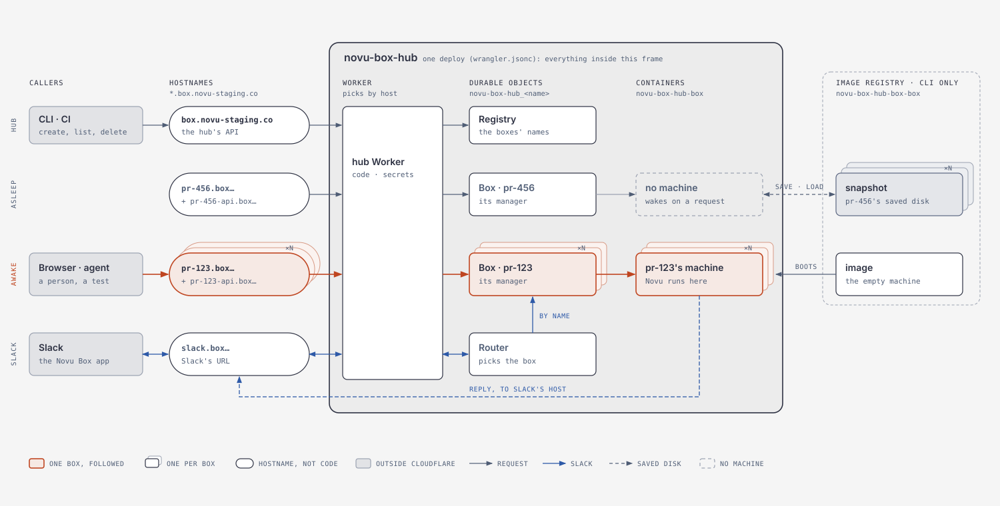

# Novu Box

A full Novu Cloud stack (enterprise API, worker, socket worker, dashboard, every data store, a sink for every
channel, and a code-first bridge app with agents) in one container per box on Cloudflare. A PR, or your checkout,
runs on it with production builds, so people and coding agents can try a change end to end before it merges.



## Quick start

You need `gh` signed in as someone with push access to `novuhq/novu`. No secrets on your machine.

```sh
npm ci --prefix docker/box                 # once, and after docker/box/package-lock.json changes
node docker/box/src/cli/main.ts up         # your branch's box, with your checkout on it
node docker/box/src/cli/main.ts doctor     # "ok": true when it's fit to test on
```

`up` prints the box's addresses: the dashboard at `https://<branch>.box.novu-staging.co` (the box's Mailpit under
`/mail`), and the API at `https://<branch>-api.box.novu-staging.co`. After more changes, `sync` puts them on the
box. Coding agents follow
the `verify-in-box` skill (`.cursor/skills/verify-in-box/SKILL.md`).

## Commands

`node docker/box/src/cli/main.ts <command>`, from anywhere in the checkout. Every command takes `--box <name>`
(default: the current branch's box); `--help` lists every option.

| Command | What it does |
|---|---|
| `up` | Starts the box: a new one starts from `base` (below) and gets your checkout, an asleep one wakes. Waits until `doctor` passes. A new box named with `--box` needs `--from base` (otherwise it bakes `next`) and a `sync` |
| `sync [--full]` | Puts this checkout on the box, committed or not, and rebuilds what it changes. `--full` rebuilds everything |
| `doctor` | Whether the box is fit to test on, as JSON; `problems` says what isn't, and it exits 1 if any |
| `logs [process]` | The last lines of one process (`api`, `worker`, `bridge`, …) or of all of them. `--errors`, `--follow`, `--tail <n>` |
| `mail [search \| id]` | What the box sent: email, and SMS, push and chat through the sink. A search (`to:a@b.c`, `subject:Welcome`, `tag:sms`), or one message with its headers, links and an HTML check of which email clients break on what |
| `exec -- <command>` | Runs a command in the box's checkout (`/data/novu`) |
| `user create \| list \| channels \| team \| delete` | Dashboard test users (below) |
| `down` | Saves the box to its snapshot and stops it; the next request or `up` wakes it with its data |
| `delete` | Stops the box, forgets its snapshot, and deletes its test users |
| `deploy` | Deploys the Cloudflare host (maintainers, below) |

`sync` sends HEAD plus every change, untracked files included (only inside the repo's existing top-level folders)
and ignored files not, as a git bundle; your index stays as it is. It stops over 25 MB, and it sends the
enterprise submodule's commit, not uncommitted changes inside `.source`. The box merges it onto the commit it was
baked from, like CI's merge ref, and stops on a conflict: rebase onto `next`, then sync again.

## Per pull request: the `box` label

`.github/workflows/novu-box-pr.yml` gives a PR its own box, `pr-<number>`, when someone with write access to
`novuhq/novu` adds the `box` label.

- The box starts from `base` and applies the PR's head; every push applies the new head (a newer push cancels the
  older run).
- One comment on the PR, edited in place, shows the box's address, the applied commit and what was rebuilt, or what
  failed; ⚠️ when the apply ran but `doctor` then found problems.
- Once the box is healthy, TesterArmy (project Novu Box) tests it: its exploration agent, which reads the PR and
  tests what it changes, and `PR smoke`, a few minutes of the main flows (sign-in, every channel, the API key,
  the editor, digest, an agent in web chat). They report on the PR as checks. The tests live in TesterArmy, not in
  this repo. Its other groups run every night after the rebake, on `nightly-<run id>`, a fresh copy of `base` that
  the next night's cleanup deletes: `Full` (everything in the dashboard), `Full: Slack` (the agents in Slack, one
  test at a time) and `Full: account` (sign up, onboard, delete). Their results are in TesterArmy only.
- Closing the PR or removing the label deletes the box. At most 30 PR boxes exist at once. PRs from forks get no
  box.
- The workflow holds no secrets: it signs in to the boxes with its GitHub OIDC token.



## What's in a box



process-compose (`image/process-compose.yaml`) supervises:

| Process | What it is |
|---|---|
| `api`, `worker` | The production builds (`pnpm deploy` output) under `pm2-runtime`, as in the production images |
| `socket` | The socket worker, for realtime Inbox |
| `dashboard` | The built dashboard, served by Caddy |
| `bridge` | `playground/nextjs`: code-first workflows and one agent per `novu connect` runtime, on the checkout's `@novu/framework` |
| `thalamus` | The managed-agent runtime (only with `NOVU_MANAGED_CLAUDE_API_KEY`) |
| `stripe` | `stripe listen`, forwarding the Stripe sandbox's webhooks to the API |
| `mongo`, `redis-7000..7002`, `clickhouse` | MongoDB 8 (replica set), a 3-node Redis 7.2 cluster over TLS, ClickHouse 24.3 |
| `s3`, `sqs` | versitygw (S3 API) and ElasticMQ (SQS API, `sqs_bullmq` mode, the Novu queues) |
| `mail`, `sink` | Mailpit catches every email; the sink (`src/box/sink.ts`) shows SMS, push and chat messages there too |

A box has two hosts, `<box>` and `<box>-api` under `box.novu-staging.co`, and Caddy (`image/config/Caddyfile`)
routes both by path: `/v1`, `/v2` and `/.well-known` to the API, `/ws` to the socket worker, `/mail` to Mailpit,
`/novu-box` and `/cdn` to S3, the rest to the dashboard. The dashboard calls the API on its own host, so CORS is
exercised as in production.

The bake seeds:

- the seed user `agent@novu.co` (password: the `BOX_SEED_PASSWORD` secret) and its org, on the Team plan;
- Mailpit as the email integration, and SMS, push and chat integrations pointing at the sink, with the seed
  subscriber's phone, push token and chat webhook, so Test Workflow reaches every channel;
- the bridge app synced to the Development environment, and its agents linked to web chat.

## How a change gets built

An apply (from `sync`, a PR push, or `base`'s refresh) logs its plan first, for example
`plan: install no, build @novu/worker, restart worker`, then builds only what the change needs:

- **API or worker files:** only the changed files are compiled, with Nest's SWC compiler and the app's own config
  (the same output as `nest build`). A new, deleted or renamed file, or a config change, builds the app in full.
- **A library:** that library, then the libraries depending on it whose output can change, through nx.
  `@novu/framework` builds without its type declarations unless something compiles against them.
- **`pnpm-lock.yaml`, `pnpm-workspace.yaml` or `.source`:** everything (reinstall, build, redeploy, restart).
- **`@novu/framework`, `@novu/agent-toolkit` or `playground/nextjs`:** the bridge app is rebuilt and synced again.

The box skips type checks, so it runs code CI would reject; `apply` logs a WARN when the PR's CI failed. One apply
runs at a time; an interrupted one is completed by the next. Measured on Cloudflare (standard-4):

| Step | Time |
|---|---|
| A new box from `base` | about 30 s, of which the restore is 1 to 2 s; about 3.5 min for the first one in a location after `base` was rebaked (a cold restore, about 3 min of it) |
| Wake after sleeping | about 30 s |
| Apply: an API change / a worker change / the dashboard | 40 s / 16 s / 23 s |
| Apply: a library / `@novu/framework` / the bridge app | 50 to 120 s / 114 s / 62 s |
| Apply: a lockfile change | about 5 min |
| A full bake of `next` | 10 to 15 min |

A box sleeps after an hour without requests: it saves itself to a snapshot and stops, and the next request wakes it
with its data (a "waking up" page meanwhile). While it saves, requests get 503 with `Retry-After`.



## Test users: `box user`

The seed user is shared by every box. For a fresh org, a real onboarding, or several users:

```sh
node docker/box/src/cli/main.ts user create      # agent+<box>.<id>@novu.co and a random password
```

Sign in with it on the dashboard; Novu creates its org and environments as for any new customer. Then, if needed,
`user channels <email>` connects the box's Mailpit and sink to that org, and `user team <email>` puts it on the
Team plan. A user works only in the box it was created for. `user delete <email>` deletes it; deleting a box
deletes its users. Clerk's development instance holds 100 users for all boxes, so `create` removes the oldest test
users past 50. The seed user and its org are never touched.

## Slack: Novu Box in `#novu-box`

The boxes' agents can be used from the company Slack through one app, Novu Box:

1. Pick a box and agent with a "Talk to" button in `#novu-box`, or `/novu-box <box> [agent]`.
2. @mention Novu Box in `#novu-box`, or DM it. A thread keeps its box and agent.
3. A sleeping box is woken (about 40 s); the message is delivered when it's up.

A Slack router (`src/cloud/slack/`) runs on the host and stands between Slack and every box: it holds the real bot
token, gives each box made-up credentials, and passes only the Slack methods agents use, only in `#novu-box` and
DMs. No box ever sees the real token. The Slack app's event, interactivity and `/novu-box` request URLs are all
`https://slack.box.novu-staging.co/slack`.



## Running the host (maintainers)

Every box runs in one Cloudflare Worker, `novu-box-hub` (`src/cloud/`, defined by `wrangler.jsonc`): one Durable
Object and one container per box, the Slack router, and a registry of the boxes `up` created. It picks what a
request reaches by hostname: `box.novu-staging.co` is the hub's own API, `slack.box.novu-staging.co` the Slack
router, and `<box>` or `<box>-api` that box. So a box name can't be `slack` or end in `-api`.



**The domain:** staging's zone `novu-staging.co`, in the same Cloudflare account. Universal SSL covers only one
level of subdomain, so the hub's Custom Domain `box.novu-staging.co` is what brings a free certificate for
`*.box.novu-staging.co` too; keep it attached. A proxied DNS record `*.box` (AAAA `100::`, set by hand) and the
route `*.box.novu-staging.co/*` (in `wrangler.jsonc`) send every box's host to the hub. A new box needs no DNS,
certificate or Worker of its own; a host of a box `up` didn't create gets 404.

**Where boxes live:** a Durable Object stays in the Cloudflare location of its first request, and its container
runs there. `base` makes the first request to every new box, so new boxes live in base's location (Frankfurt) and
restore its snapshot in seconds; a box created before that keeps its location, and so does a name deleted and used
again.



**Deploy:** `node docker/box/src/cli/main.ts deploy`, with `npx wrangler login` on the Novu Cloudflare account and
Docker (wrangler builds the image). A deploy applies to every box. A snapshot restores on the image it was taken
on, so after a new image a box keeps running the old one until it starts again from `base` rebaked on the new image
(`box delete`, then `box up --from base`; for `base` itself, Run workflow → `rebake` in Novu Box base). To deploy
only code on the current image, set `BOX_IMAGE` to the image's reference (from `npx wrangler containers images
list`).

**`base`:** the box new boxes start from. `novu-box-base.yml` refreshes it on every push to `next` (applies the new
head, about 4 min). At 04:17 UTC `novu-box-nightly.yml` rebakes it through that workflow, then runs the full suite
on `nightly-<run id>`; next to that it deletes the boxes of closed or unlabeled PRs, and those of earlier runs
(`base-next-*`, `nightly-*`) an hour idle. Its Run workflow button does the same by hand. A rebake bakes in a
separate box (`base-next-<run id>`, a fresh name every run, see where boxes live above) and `base` takes over its
snapshot only once it's saved, so `base` is never missing; a refresh that fails keeps the last good snapshot.
A new box restores every byte of base's snapshot chain, so the bake and each refresh drop nx's cache before they save
(base's bake snapshot is about 3.8 GB; pnpm's store and cache stay, so a lockfile change doesn't download again).
Snapshots expire 30 days after they were made or last restored, and nothing deletes old ones.

**Secrets** are Worker secrets of `novu-box-hub`, set only in Cloudflare (dashboard → Workers → `novu-box-hub` →
Settings → Variables and Secrets, or `npx wrangler secret put <NAME>`). `deploy` never reads secret files; it warns
about missing ones.

| Secret | In boxes | For |
|---|---|---|
| `CLERK_SECRET_KEY` | yes | Clerk's development instance (app `novu-box`): the seed user, test users, the API |
| `BOX_SEED_PASSWORD` | yes | The seed user's password (in the password manager) |
| `STRIPE_API_KEY` | yes | The Stripe sandbox `Novu Box` (`sk_test_...`) |
| `LAUNCH_DARKLY_SDK_KEY` | yes | Staging's flags, read-only |
| `NOVU_MANAGED_CLAUDE_API_KEY` | yes, optional | Real models for the agents and the managed agent (an Anthropic workspace with a spend limit) |
| `BULL_MQ_PRO_NPM_TOKEN` | yes, optional | BullMQ Pro; without it, open-source BullMQ |
| `NX_CLOUD_ACCESS_TOKEN` | yes, optional | Reads CI's Nx Cloud cache. **Read-only only**: PR code can read it |
| `GITHUB_READ_TOKEN` | no | Read-only access to `novu` and `packages-enterprise` for the boxes' git fetches |
| `SLACK_BOT_TOKEN`, `SLACK_SIGNING_SECRET` | no | The Slack router |
| `TESTERARMY_API_KEY` | no, optional | Starts TesterArmy's runs on PR boxes |
| `CURSOR_BOX_TOKEN` | no, optional | Lets Cursor Cloud agents use boxes. Also a Cursor team Runtime Secret, same name and value |

A box runs PR code, which can read its environment: never put production keys in boxes, never name a secret
`VITE_*` (it would end up in the dashboard's public `index.html`), and never run boxes for PRs from forks.

**Who can get in:** every box command needs a GitHub token with push access to `novuhq/novu`, the OIDC token of
one of the Novu Box workflows, or `CURSOR_BOX_TOKEN`. Cursor Cloud agents' `gh` is the Cursor GitHub App, which can't
push, so they get that secret instead: it opens boxes and nothing on GitHub. Don't name it `GITHUB_TOKEN` in Cursor:
`gh` would use it instead of the app's token and stop opening PRs.

Box addresses are public, like staging's; the dashboard is protected by Clerk. Keep these two Clerk settings, or
anyone could sign up: email-code sign-in **off** (sign-in needs the password), and test mode **off** (it accepts
`424242` as any address's code). Sign-up is limited to `@novu.co` addresses, and `@qa.box.novu-staging.co` for
TesterArmy's sign-up tests: Cloudflare Email Routing forwards those addresses to TesterArmy's inbox, and each time
the hub starts TesterArmy it deletes those users over an hour old.

## Troubleshooting

- **`doctor` reports problems:** `logs <process> --errors` for the process it names; an unfinished apply is fixed
  by syncing again.
- **Mailpit has no SMS, push or chat:** check `sink` in `logs`, and that the step uses one of the `Box … (sink)`
  integrations (`user channels` for a test user's org).
- **`sync` stops on a conflict:** the branch doesn't contain `base`'s commit; rebase onto `next`.
- **A slow first start:** right after `base` was rebaked, the first box in a location restores a fresh snapshot
  and is up in about 3.5 min (the restore takes about 3 of it). A restore that hasn't answered in 5 min is started
  again once from the same snapshot (`lastStart.attempts` in `/__box/state`).
