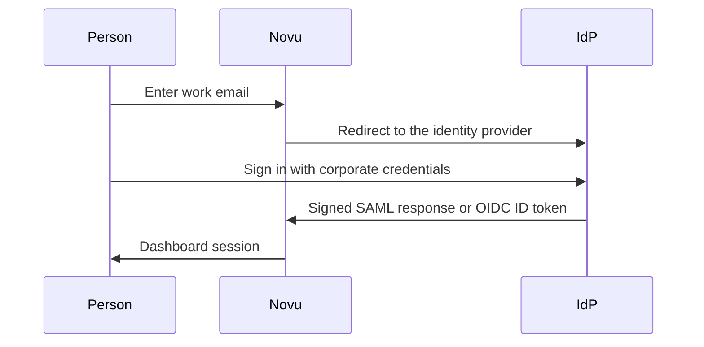

<Note>
  SAML SSO, OpenID Connect (OIDC), and directory sync are available to Enterprise customers on [Novu Cloud](https://dashboard.novu.co). Self-hosted Novu signs in with email and password. See [pricing](https://novu.co/pricing) and [Self-hosted and Novu Cloud](/community/self-hosted-and-novu-cloud).
</Note>

Use this when your company wants the Novu dashboard to follow the same identity provider (IdP) you already use for other internal tools. People sign in with their work account. When someone leaves, you remove their dashboard access from that directory instead of resetting a password in Novu.

This page is about the people who sign in to Novu. It does not create [subscribers](/platform/additional-resources/glossary#subscriber). Subscribers are the people your workflows notify, and they stay under your control through the API.

For Google, GitHub, and email-and-password sign-in, see [Authentication](/platform/account/authentication). For roles after someone is in the organization, see [Roles and permissions](/platform/account/roles-and-permissions).

## What you can connect

Novu is the service provider. Your IdP checks the person's credentials, including any MFA the IdP requires, and sends Novu a signed login. Novu then opens the dashboard session.

| Protocol | Use it when | Providers |
| --- | --- | --- |
| SAML 2.0 | Your IdP has a SAML enterprise application, which is the usual choice for workforce SSO. | [Okta Workforce](/platform/account/sso/okta), [Microsoft Entra ID](/platform/account/sso/microsoft-entra), [Google Workspace](/platform/account/sso/google-workspace), and [any other SAML 2.0 provider](/platform/account/sso/custom-saml). |
| OpenID Connect | Your IdP issues an OIDC ID token with the authorization code grant. | [Any OIDC provider](/platform/account/sso/oidc). |
| Directory sync | You want joiners, profile updates, and leavers pushed from the directory without waiting for a first login. | [SCIM 2.0](/platform/account/directory-sync) for Okta, Entra, and other SCIM providers. [Google Workspace](/platform/account/directory-sync/google-workspace) is read through the Admin SDK, not SCIM. |

Directory sync is attached to an SSO connection. Set up SAML or OIDC first. You can finish the directory configuration before you activate SSO. People can be provisioned in that window, but they cannot sign in until SSO is active.

An SSO domain is not the same thing as a [verified domain](/platform/account/manage-members#add-a-verified-domain-for-automatic-or-request-based-onboarding). A verified domain lets colleagues join the organization. An SSO domain forces sign-in through the IdP. You can use both. Verifying a domain for invitations does not turn on SSO.

## Choose how to configure it

You need someone who can publish a DNS TXT record for the email domain, and someone who can create an application in the IdP. Those are often two different people. Each provider guide is a separate page, so you can hand the IdP admin the Okta, Entra, or Google Workspace page on its own.

### We configure it with you

Email [support@novu.co](mailto:support@novu.co) or message your Slack Connect channel and tell us the email domain and the IdP. We send you the service provider values for that provider (the URLs and IDs in the provider guide). You create the application, then send us the IdP metadata, or the OIDC client credentials if that is the protocol you are using. We test with you and turn the connection on.

Use this when you want us to own the Novu side, or when the Security tab described next is not available yet.

### You configure it from the dashboard

Self-serve setup is off until we enable it for your organization. After that, the organization **Owner** sees a **Security** tab on **Settings** > **Organization**:

[https://dashboard.novu.co/settings/organization#/organization-security](https://dashboard.novu.co/settings/organization#/organization-security)

Other roles do not see that tab. If you are the IdP admin and not the Owner, do the IdP work together with the Owner, or ask the Owner to open the page.

If the tab is missing, self-serve is not enabled. Ask us to turn it on, or use the assisted path above. There is nothing to flip in the dashboard until we do.

The Security tab walks through domain verification, the IdP, a test sign-in, and activation. Directory sync is on the same tab, under the SSO section.

## Set up SSO from the dashboard

<Steps>
  <Step title="Open Security as the Owner">
    Go to **Settings** > **Organization** > **Security**, or use the link above.
  </Step>
  <Step title="Verify the email domain">
    Add the domain people will sign in with, such as `acme.com`. The page shows a DNS TXT record. Publish that record, then come back and confirm the domain is verified. You can add more than one domain. The connection cannot be configured until at least one domain is verified.

    For SAML, the match is exact. A connection for `acme.com` accepts `alex@acme.com` and does not accept `alex@sales.acme.com`. Subdomain matching is not on this page. Ask us if you need it. The domain on the connection has to be a registrable domain, such as `acme.com`, before subdomain matching can be enabled.
  </Step>
  <Step title="Choose the provider">
    Under SAML, the choices are **Okta Workforce**, **Microsoft Entra** (formerly AD), **Google Workspace**, and **Custom SAML Provider**. Under OpenID Connect, the choice is **OIDC Provider**.

    Switching an existing connection to a different provider removes the current connection and starts the configuration again. The page warns you before it does that.
  </Step>
  <Step title="Configure the IdP">
    Open the guide for your provider. The Security tab shows the values to paste into the IdP, and the place to paste the IdP's metadata or credentials back.
  </Step>
  <Step title="Run a test sign-in">
    Use a person who is assigned to the application in the IdP and whose email is on a verified domain. For a new connection, this test does not change sign-in for anyone else. The connection is not live until you activate it.
  </Step>
  <Step title="Activate the connection">
    After the test succeeds, activate it. From that moment, anyone signing in with an email on a verified domain must use the IdP.
  </Step>
</Steps>

<Warning>
  Editing a connection that is already active applies immediately. A wrong URL, certificate, or attribute mapping can stop everyone on that domain from signing in, including people who already had a Novu account. Change a live connection when someone is available to fix a failed login, and run the test again.
</Warning>

## How sign-in works

People start from the Novu sign-in page. They enter their work email. Novu sends them to the IdP, the IdP authenticates them, and they return to the dashboard.

A few consequences that are easy to miss:

- For a SAML connection, an existing Novu account with a matching email is linked to the enterprise login. The person keeps that account and signs in through the IdP from then on.
- If the person also has multi-factor authentication on their Novu account, they still complete that step after the IdP accepts them.
- Someone who is not assigned to the application in the IdP cannot sign in, even if they know the Novu URL.
- If the connection is removed, Novu accounts are not deleted. Those people need another sign-in method that is still available on the account, such as a password, Google, or GitHub.
- Starting login from an app tile inside the IdP (IdP-initiated SAML) is a separate switch. It is not part of the Security tab, and it is not available for OIDC. The sign-in flow above is the one to use. Ask us if you have a specific reason to start from the IdP.

### Team members who sign in currently with Google or GitHub

**Continue with Google** and **Continue with GitHub** on the sign-in page are available to every Novu Cloud account. They are separate from the SSO connection for your organization. Using one of those buttons is not the same as having SSO configured.

After you activate the connection, a person whose email is on a verified domain keeps the same Novu account. Sign-in for that email goes through the IdP. They can start in either of these ways:

- Enter the work email and select **Continue**. Novu sends them to the IdP. There is no password step for that email.
- Select **Continue with Google** or **Continue with GitHub** and choose the account that uses that work email. Google or GitHub confirms the account, then Novu sends them to the IdP before opening the dashboard.

A person whose email is not on a verified domain can keep using Google, GitHub, or a password. A person the IdP does not assign to the Novu application cannot sign in, including someone who previously used the Google button.

Without directory sync, a person is created in Novu when they first sign in through SSO. That is just-in-time provisioning. Directory sync creates and deactivates people from the directory itself, so a leaver loses access without having to open Novu again.

## Provider guides

The IdP steps are the same whether you use the Security tab or we configure the connection with you. What changes is where the service provider values come from, and where you return the IdP metadata.

<CardGroup cols={2}>
  <Card title="Okta Workforce" href="/platform/account/sso/okta">
    SAML application, attribute statements, and metadata URL.
  </Card>
  <Card title="Microsoft Entra ID" href="/platform/account/sso/microsoft-entra">
    Non-gallery enterprise app, claims, and federation metadata.
  </Card>
  <Card title="Google Workspace" href="/platform/account/sso/google-workspace">
    Custom SAML app in the Admin console.
  </Card>
  <Card title="Custom SAML provider" href="/platform/account/sso/custom-saml">
    Any other SAML 2.0 identity provider.
  </Card>
  <Card title="Custom OpenID Connect" href="/platform/account/sso/oidc">
    Authorization code flow, discovery URL, client ID, and secret.
  </Card>
</CardGroup>

## Directory sync

Directory sync provisions and deprovisions the people who can sign in to this organization. It is a separate setup from SSO, on the same Security tab, and it needs an SSO connection first.

<CardGroup cols={2}>
  <Card title="How directory sync works" href="/platform/account/directory-sync">
    SCIM attributes, bearer tokens, offboarding, and what the Security tab does.
  </Card>
  <Card title="Okta" href="/platform/account/directory-sync/okta">
    SCIM connector base URL, API token, and push settings.
  </Card>
  <Card title="Microsoft Entra ID" href="/platform/account/directory-sync/microsoft-entra">
    Tenant URL, secret token, and automatic provisioning.
  </Card>
  <Card title="Google Workspace" href="/platform/account/directory-sync/google-workspace">
    Service account, domain-wide delegation, and Admin SDK sync.
  </Card>
  <Card title="Custom SCIM" href="/platform/account/directory-sync/custom-scim">
    Any SCIM 2.0 provider behind a custom SAML or OIDC connection.
  </Card>
</CardGroup>

## If sign-in or provisioning fails

<AccordionGroup>
  <Accordion title="The test worked, but nobody else is redirected">
    The connection is not active yet. A successful test does not change sign-in for the domain. Activate it after you are ready for that domain to use the IdP. The same check is on each provider page, next to the steps.
  </Accordion>
  <Accordion title="The person returns from the IdP and Novu still has no email">
    The required attribute is missing or named differently. [Okta](/platform/account/sso/okta) needs `mail`. [Google Workspace](/platform/account/sso/google-workspace) needs the app attribute `email`. A [custom SAML provider](/platform/account/sso/custom-saml) needs `mail`. [Entra](/platform/account/sso/microsoft-entra) needs the email claim mapped from `user.mail`. For SCIM, `emails` has to be present even when `userName` is an email address. See [Directory sync](/platform/account/directory-sync).
  </Accordion>
  <Accordion title="The user is sure they have an account in the IdP">
    They also have to be assigned to the Novu application. In Google Workspace, the SAML app has to be **ON** for their organizational unit.
  </Accordion>
  <Accordion title="A subdomain address does not match">
    For SAML, `sales.acme.com` does not use a connection registered for `acme.com` unless we have enabled subdomain matching. The address also has to be on a domain you verified with the TXT record.
  </Accordion>
  <Accordion title="SCIM says the token is invalid">
    The bearer token was copied incompletely, or a new token was generated and the 10-minute overlap has passed. Generate a new token, put it in the IdP, and save. Details are on [Directory sync](/platform/account/directory-sync).
  </Accordion>
  <Accordion title="A user you removed in the IdP can still open Novu">
    Wait for the next provisioning cycle. Entra and Okta are often several minutes behind. Google is about five minutes, or immediate if you use **Sync now**. Then check whether they still have a membership that was created by invitation rather than by the directory.
  </Accordion>
  <Accordion title="SAML sign-in fails just after a certificate change">
    The connection still has the previous signing certificate. Update the certificate on the connection, or send us the new one, before the IdP stops using the old certificate. On a live connection that update applies immediately.
  </Accordion>
</AccordionGroup>

## Ask us for help

Email [support@novu.co](mailto:support@novu.co) or your Slack Connect channel. Tell us the organization name, the email domain, and the IdP. If a test sign-in or a SCIM push failed, include the error from the IdP and the email address you tried. That is enough for us to see whether the connection, the claim mapping, or the directory is what rejected it.

## Related topics

<Columns cols={2}>
  <Card title="Authentication" icon="key" href="/platform/account/authentication">
    Google, GitHub, email and password, MFA, and sessions.
  </Card>
  <Card title="Organizations" icon="building-2" href="/platform/account/organizations">
    How organizations, environments, and billing fit together.
  </Card>
  <Card title="Team members" icon="users" href="/platform/account/manage-members">
    Invitations, verified domains, and removing members by hand.
  </Card>
  <Card title="Roles and permissions" icon="shield" href="/platform/account/roles-and-permissions">
    What Owner, Admin, Author, and Viewer can do after sign-in.
  </Card>
</Columns>
